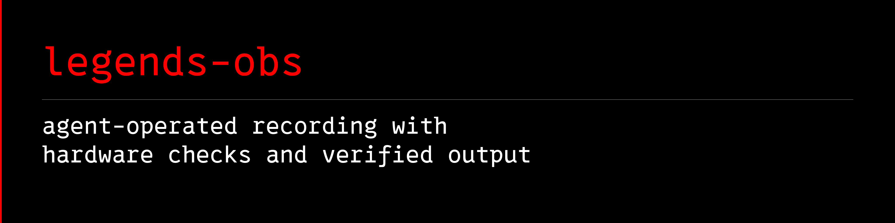
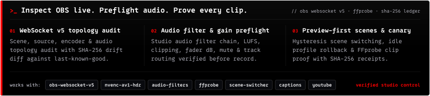
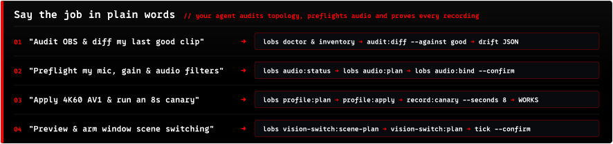
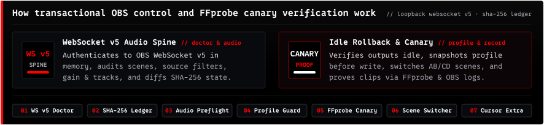
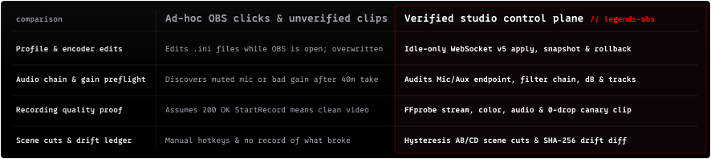

<a name="banner"></a>
<a name="legends-obs"></a>
<a name="legends-obs-kit"></a>

# 

[](https://github.com/avalonreset/legends-obs/releases/latest)
[](https://github.com/avalonreset/legends-obs/actions/workflows/ci.yml)
[](package.json)
[](src/obs-websocket.ts)
[](src/manifest.ts)
[](LICENSE)

**OBS Studio WebSocket v5 control, audio filter chain preflight, encoder profile guard, window-aware scene switcher, and FFprobe recording verification CLI (`legends-obs` / `lobs`) for coding agents on Windows: audit live scenes, sources, filters, encoders, and audio tracks, diff against your last-known-good SHA-256 ledger, apply idle-only profile updates with automatic rollback, and prove every recording on disk before a long take.**


```text
Install or update legends-obs via cto-legends (https://github.com/avalonreset/cto-legends): run `cto-legends install legends-obs --apply`, then `cto-legends handoff legends-obs` and follow the returned JSON recipe to verify `legends-obs` (`lobs`).
```



## Why `legends-obs` exists

Recording a forty-minute product walkthrough or engineering demo only to discover a muted USB microphone, wrong gain or missing source filter chain, dropped encoder frames, or washed-out HDR color space is painful. An unassisted coding agent trying to automate OBS Studio typically hits three failure modes:

1. **Editing `.ini` files while OBS Studio is open:** OBS caches profile and scene settings in memory and overwrites edited disk files on exit. Even when `.ini` changes survive a restart, they do not rebuild the active OBS video pipeline until `SetVideoSettings` is called over the live control plane and read back.
2. **Assuming `200 OK` from `StartRecord` means the video and audio actually work:** A WebSocket command that starts recording says nothing about whether NVENC initialized cleanly, whether the container carries the right color transfer and frame rate, whether a stale Windows audio endpoint silently muted your primary Mic/Aux track, or whether render and output frames are dropping.
3. **No memory of what changed since your last clean recording:** When a Windows update, unplugged audio interface, or accidental menu click breaks a previously working setup, an agent without a hardware-specific settings ledger has to guess at OBS menus instead of diffing live state against the exact snapshot that last produced a verified clip.

`legends-obs` (also invokable via the short alias `lobs` or compatibility alias `legends-obs-kit`) replaces fragile UI macros and blind `.ini` edits with a deterministic flight recorder and verification loop over OBS Studio's built-in loopback WebSocket v5 server. It works seamlessly upstream of [`legends-captions`](https://github.com/avalonreset/legends-captions) and [`legends-youtube`](https://github.com/avalonreset/legends-youtube) with zero ambient MCP server and zero secret exposure.

## Ask in plain english

Once [`cto-legends`](https://github.com/avalonreset/cto-legends) is installed, you ask your coding agent in plain english. It inspects live OBS topology, preflights your microphone and audio filter chain, previews profile or scene changes in dry-run mode first, and verifies the resulting recording clip with FFprobe:



## Architecture: loopback WebSocket v5 control and FFprobe canary proof



### 1. In-memory loopback WebSocket v5 spine & hardware topology audit (`doctor`, `inventory`, `audit:*`)

- **Strict loopback authentication (`src/obs-websocket.ts`, `src/obs-config.ts`):** Connects directly to `127.0.0.1`, `::1`, or `localhost` using the local OBS WebSocket v5 configuration (`%APPDATA%\obs-studio\plugin_config\obs-websocket\config.json`). Credentials stay in memory and are never printed, copied, or written to transcripts.
- **OBS 32.2+ and 33.0 Safe Mode & NVENC diagnostics (`src/doctor.ts`):** Hard-gates local authenticated OBS control while reporting NVENC SDK 13 / driver 570+ AV1 readiness (`nvenc-av1`), HDR display profiles and `sdr_on_hdr_filter` / `hdr_tonemap_filter` availability (`display-hdr-mode`), FFprobe readiness, recording directory writability, and unclean-shutdown crash sentinels (`run_*`, `.sentinel`) when OBS is paused on a Safe Mode prompt.
- **Two-pointer SHA-256 settings ledger (`src/audit.ts`, `src/inventory.ts`):** Captures redacted snapshots of GPU adapters, loaded encoders, profile and global `.ini` settings, scene graphs, source filter chains, and audio routing under `%LOCALAPPDATA%\LegendsOBS\state`. Separates `latest` (last observed) from `last-known-good` (advanced only after a passing `record:canary`) so `lobs audit:diff --against good` pinpoints exact JSON drift paths.

### 2. Studio audio filter chain, gain, and endpoint preflight (`audio:status`, `audio:plan`, `audio:bind`)

- **Primary Mic/Aux and filter chain audit (`src/audio.ts`, `src/inventory.ts`):** Inspects WASAPI audio input endpoints, per-source filter chains and filter default settings (`GetSourceFilterList`, `GetSourceFilterDefaultSettings`), mute state, fader multiplier and dB gain (`inputVolumeMul`, `inputVolumeDb`), audio balance, sync offset, monitor type, and multi-track routing (`routedTracks`).
- **Transactional idle-only endpoint binding (`audio:bind`):** Resolves an enabled audio interface by unique name fragment or exact device ID (`audio:plan`), verifies all OBS outputs are idle, captures a pre-mutation audit, binds the endpoint, waits for settle, and reads back healthy status. If readback fails, `audio:bind` automatically rolls back to the prior device ID and verifies recovery.

### 3. Transactional profile guard, FFprobe canary proof & window-aware scene switcher (`profile:*`, `record:canary`, `vision-switch:*`)

| Surface | `lobs` Subcommands | What It Enforces |
| :--- | :--- | :--- |
| **Readiness & Topology** | `doctor`, `manifest`, `agent:context`, `status`, `inventory`, `logs:latest` | Loopback WebSocket v5 handshake, Safe Mode sentinel detection, GPU/encoder/filter inventory, and redacted OBS log tail inspection. |
| **SHA-256 Drift Ledger** | `audit:status`, `audit:capture`, `audit:show`, `audit:diff`, `audit:verify` | Immutable hardware and settings snapshots with separate `latest` and canary-qualified `last-known-good` pointers plus secret-scanned SHA-256 verification. |
| **Studio Audio Preflight** | `audio:status`, `audio:plan`, `audio:bind` | Primary Mic/Aux endpoint health, fader dB and mute checks, active track routing verification, and idle-only endpoint binding with automatic rollback. |
| **Transactional Profile Guard** | `profile:show`, `profile:plan`, `profile:backup`, `profile:apply`, `profile:refresh`, `profile:rollback` | Explicit `--preset` diffing, pre-write rollback snapshots, idle-output enforcement, live `SetVideoSettings` pipeline refresh, and fail-closed rollback on mismatch. |
| **Recording & FFprobe Canary** | `record:status`, `record:start`, `record:stop`, `record:canary`, `receipts:list`, `receipts:verify` | Short local test recording (`3..30s`) probed via FFprobe for exact codec, resolution, FPS, bit depth, color tuple, audio streams, zero encoder log errors, and frame-drop bounds. |
| **Window-Aware Scene Switcher** | `vision-switch:scene-plan`, `scene-apply`, `status`, `plan`, `arm`, `disarm`, `freeze`, `unfreeze`, `tick`, `daemon` | Honest-pixel `panel-ab` / `panel-cd` scene graph planning (rejecting stretched scaling), 2-sample hysteresis, `obs_recursion_guard` when focusing OBS, and idle-only transactional renames. |

## Ad-hoc OBS clicks vs `legends-obs`



## Quick start

In OBS Studio on Windows, open **Tools -> WebSocket Server Settings**, enable the server, keep authentication enabled, and preserve the generated password. Then run:

```powershell
# 1. Verify authenticated loopback control, hardware encoders, audio, and ledger health
lobs doctor --pretty
lobs manifest --pretty
lobs agent:context --pretty

# 2. Inspect live status, redacted hardware/scene/filter inventory, and audio readiness
lobs status --pretty
lobs inventory --pretty
lobs audio:status --pretty

# 3. Capture a baseline snapshot and diff live OBS against last-known-good
lobs audit:status --pretty
lobs audit:capture --reason first-baseline --pretty
lobs audit:diff --against good --pretty

# 4. Preview a profile preset or window-aware AB/CD scene cut in read-only dry-run mode
lobs profile:plan --preset hdr-4k60-av1-hybrid-mp4 --pretty
lobs vision-switch:scene-plan --pretty
lobs vision-switch:plan --panel C --process chrome --pretty
```

All OBS mutations require both live mode (`LEGENDS_OBS_DRY_RUN=false`) and `--confirm`. Profile and canary commands also require an explicit `--preset` so a hardware-specific recording recipe is never applied by accident:

```powershell
try {
  $env:LEGENDS_OBS_DRY_RUN = "false"
  lobs profile:apply --preset hdr-4k60-av1-hybrid-mp4 --confirm --pretty
  lobs record:canary --preset hdr-4k60-av1-hybrid-mp4 --seconds 8 --require-microphone --confirm --pretty
}
finally {
  $env:LEGENDS_OBS_DRY_RUN = "true"
}

lobs receipts:verify --pretty
lobs audit:verify --pretty
```

## Reference

<details>
<summary><strong>Agent setup (via <code>cto-legends</code>), release tarball, and source build</strong></summary>

### Agent setup (via `cto-legends`)

Part of the [cto-legends](https://github.com/avalonreset/cto-legends) ecosystem. `cto-legends` is the only registered skill; this repo vendors a pinned copy at [skills/cto-legends/SKILL.md](skills/cto-legends/SKILL.md). Do not register `legends-obs` as its own standalone skill.

The product, repository, npm package, and catalog ID are `legends-obs`. The CLI installs three bin entrypoints pointing to `./dist/index.js`: `legends-obs`, the short alias `lobs`, and the legacy compatibility alias `legends-obs-kit`.

Run `cto-legends handoff legends-obs` to load the installed module recipe and readiness checks, or preview installation with `cto-legends install legends-obs`. See [docs/AGENT-RECIPE.md](docs/AGENT-RECIPE.md) for the complete 36-command operator contract and EDR guardrails.

### Requirements

- Windows 10 or 11
- OBS Studio 28 or newer (OBS WebSocket v5 is built in; verified through OBS Studio 32.2+ and forward checks for OBS 33.0 Safe Mode sentinels)
- Node.js 22 or newer (`pnpm` is only needed when building from a source checkout; prebuilt release tarballs include `dist/`)
- FFprobe on `PATH` for `record:canary` (or set `LEGENDS_OBS_FFPROBE_PATH` to `ffprobe.exe`)

### Install from a release tarball or source checkout

Download the release tarball and `SHA256SUMS.txt` from the [latest GitHub release](https://github.com/avalonreset/legends-obs/releases/latest), verify the SHA-256 hash with `Get-FileHash -Algorithm SHA256`, and extract:

```powershell
New-Item -ItemType Directory legends-obs-release
tar -xzf .\avalonreset-legends-obs-*.tgz -C .\legends-obs-release
Set-Location .\legends-obs-release\package
node .\dist\index.js manifest --pretty
```

To build and verify from a source checkout:

```powershell
git clone https://github.com/avalonreset/legends-obs.git
Set-Location legends-obs
corepack enable
pnpm install --frozen-lockfile
pnpm build
pnpm test
python scripts/check_release.py
```

</details>

<details>
<summary><strong>Privacy redaction, state ledger paths, and troubleshooting</strong></summary>

- **Privacy-minimized defaults (`src/redact.ts`):** `doctor`, `inventory`, `audio:status`, and audit/operation receipts redact workstation user paths, URLs with query tokens, and credential-shaped keys by default. Pass `inventory --full`, `audio:status --include-devices`, `vision-switch:status --include-window`, or `audit:show` only for local diagnostics.
- **State directory resolution (`src/config.ts`):** Machine audits, rollback snapshots, and operation receipts are stored under `%LOCALAPPDATA%\LegendsOBS\state` (automatically reusing legacy `%LOCALAPPDATA%\LegendsOBSKit\state` or `.legends-obs-kit/` directories if already initialized). Override with `LEGENDS_OBS_STATE_DIR`.
- **Why does `authenticated-control` fail when OBS is open?** Confirm **Tools -> WebSocket Server Settings** has `Enable WebSocket server` checked. If OBS was previously force-closed, check whether it is waiting on a **Safe Mode** dialog (`run_*` or `.sentinel` markers in `%APPDATA%\obs-studio`); OBS 33.0+ disables WebSocket while running in Safe Mode.
- **Why is `nvenc-av1` unavailable on OBS 32.2+?** OBS 32.2+ compiles against NVIDIA Video Codec SDK 13, which requires NVIDIA Windows driver **570+** and an AV1-capable GPU (RTX 40-series or newer).

Read [docs/TROUBLESHOOTING.md](docs/TROUBLESHOOTING.md), [docs/FIRST-RUN.md](docs/FIRST-RUN.md), [docs/RECIPES.md](docs/RECIPES.md), [docs/SAFETY.md](docs/SAFETY.md), [docs/AGENTS-MATRIX.md](docs/AGENTS-MATRIX.md), and [docs/AUDIT-LEDGER.md](docs/AUDIT-LEDGER.md) for deep-dive operational guides.

</details>

<details>
<summary><strong>Optional extra: animated cursor overlay (<code>extras/cursor/</code>)</strong></summary>

`extras/cursor/` in the repository checkout carries the optional Legends Cursor Filter for Windows software demos: smooth halo, momentum ticks, opt-in click ripples (`enable_left_click = false` and `enable_right_click = false` by default for Windows 11 Defender / EDR hygiene), comet trail, and glow. See [extras/cursor/README.md](extras/cursor/README.md) and [extras/cursor/LICENSE](extras/cursor/LICENSE).

That extra is licensed under GPL-2.0-or-later and is excluded from the `avalonreset-legends-obs-*.tgz` package tarball so the core `legends-obs` distribution remains 100% pure MIT.

<p align="center">
  
</p>

</details>

## Contributing, security, and license

See [CONTRIBUTING.md](CONTRIBUTING.md) for development checks, [SUPPORT.md](SUPPORT.md) for issue reporting, [SECURITY.md](SECURITY.md) for private vulnerability reporting, [CODE_OF_CONDUCT.md](CODE_OF_CONDUCT.md) for community guidelines, and [THIRD_PARTY_NOTICES.md](THIRD_PARTY_NOTICES.md) for upstream attribution.

MIT License for the core CLI and documentation; see [LICENSE](LICENSE) and [NOTICE](NOTICE). The separable cursor filter in `extras/cursor/` is GPL-2.0-or-later; see [extras/cursor/LICENSE](extras/cursor/LICENSE).

[](https://github.com/avalonreset/cto-legends/issues/new?title=Message%20for%20Avalon%20Reset&labels=message)

<p align="center"><a href="https://github.com/stars/avalonreset/lists/cto-legends"></a></p>

**Specification & benchmarks on cto-legends.com:**
- **Module specification & architecture matrix:** [cto-legends.com/modules/legends-obs](https://cto-legends.com/modules/legends-obs)
- **Related engineering dispatches:** [How to Build AI Agents: Production CLI & MCP Routing](https://cto-legends.com/blog?post=how-to-build-ai-agents-cli-mcp-routing) · [Claude Code Skills: MCP vs CLI Workflow Architecture](https://cto-legends.com/blog?post=claude-code-skills-mcp-vs-cli-workflow) · [Browser Automation AI: Computer Use Agent Benchmarks](https://cto-legends.com/blog?post=browser-automation-ai-computer-use-benchmarks)
- **Ecosystem hub:** [cto-legends.com/home](https://cto-legends.com/home)
