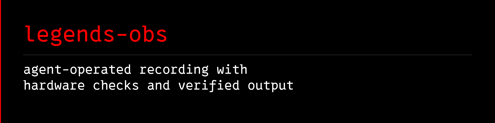

<a name="banner"></a>
<a name="legends-obs"></a>
<a name="legends-obs-kit"></a>

# 

[](https://github.com/avalonreset/legends-obs/releases/latest)
[](https://github.com/avalonreset/legends-obs/actions/workflows/ci.yml)
[](LICENSE)

**legends-obs** (Legends OBS, formerly Legends OBS Kit) is a guarded, agent-friendly **OBS Studio CLI** on Windows for inspecting hardware, planning **OBS recording settings**, preserving rollback snapshots, and verifying recordings through the built-in **OBS WebSocket** v5 API, local OBS logs, and FFprobe, with no ambient MCP server and no fragile UI click macros.

**Table of contents:** [Agent setup](#agent-setup-via-cto-legends) · [Why use this with an agent?](#why-use-this-with-an-agent) · [Requirements](#requirements) · [Install a release](#install-a-release) · [Install from source](#install-from-source) · [Quick start and usage](#quick-start-and-usage) · [Safe mutations](#safe-mutations) · [How it works and architecture](#how-it-works-and-architecture) · [Troubleshooting and FAQ](#troubleshooting-and-faq) · [Cursor overlay](#optional-extra-animated-cursor-overlay) · [Contributing](#contributing-and-support) · [License](#license)

## Agent setup (via `cto-legends`)

Part of the [CTO Legends](https://github.com/avalonreset/cto-legends) ecosystem. `cto-legends` is the only registered skill; this repo vendors a pinned copy at `skills/cto-legends/SKILL.md`.

The product, repository, npm package, and catalog ID are `legends-obs`. The former catalog and CLI name `legends-obs-kit` remains a compatibility alias for existing commands.

Install with `cto-legends install legends-obs`, then follow the module recipe the router loads. Do not register this module as its own skill.

Ask your agent to inspect your recording setup, explain what changed since a known-good recording, or plan a hardware-appropriate profile. The module keeps rollback snapshots and checks the resulting recording instead of treating a successful settings change as proof that the output works.

[recipes](docs/RECIPES.md) · [troubleshooting](docs/TROUBLESHOOTING.md) · [agent setup](docs/AGENTS-MATRIX.md) · [settings history](docs/AUDIT-LEDGER.md) · [safety contract](docs/SAFETY.md)

## Why use this with an agent?

An unassisted agent trying to automate OBS Studio typically guesses `.ini` keys, edits configuration files while OBS is open (which OBS overwrites on exit), or assumes that because an `obs-websocket` request returned `200 OK`, the recording actually works. `legends-obs` replaces guesswork with a deterministic flight recorder and verification loop:

| Recurring problem | What `legends-obs` supplies |
| --- | --- |
| Silent recording failures (wrong color tuple, dropped frames, encoder init failure, muted or stale USB mic) | `record:canary` records a short local clip and checks FFprobe stream tags, frame-drop deltas, audio signal, and the fresh OBS log before reporting `WORKS` |
| Settings changed between sessions with no record of what broke | Per-machine redacted audit ledger separating `latest` observed state from canary-qualified `last-known-good` state (`audit:diff --against good`) |
|Persisted `.ini` changes not rebuilding the active OBS video pipeline | Guarded `SetVideoSettings` pipeline refresh plus exact readback verification |
| Mid-write failure leaving OBS in a half-configured state | Pre-mutation snapshot and automatic fail-closed rollback while verifying all outputs are idle |
| Credential or private path leaks in agent transcripts | In-process WebSocket authentication (never printed or copied) and privacy-minimized default JSON output |

The universal core is hardware-neutral:

- authenticated status, scene, source, output, and profile inventory;
- per-machine settings and capability ledgers with exact drift detection;
- dry-run plans, rollback snapshots, bounded mutations, and readback;
- local recording control and FFprobe-backed canaries;
- optional microphone health/repair and deterministic scene switching.

Scene mutations currently target OBS's main canvas. `doctor` reports an advisory warning when multiple canvases make that scope ambiguous.

Bundled recording presets are opt-in examples, not universal recommendations. `doctor` reports encoder, HDR, FFprobe, recording-path, and microphone readiness as hardware-neutral capability summaries; those checks become requirements only for commands that need them.

## Requirements

- Windows 10 or 11
- OBS Studio 28 or newer (OBS WebSocket v5 is built in)
- Node.js 22 or newer
- pnpm 10 for source builds; the prebuilt release does not require pnpm
- FFprobe on `PATH` only for `record:canary` (or set `LEGENDS_OBS_FFPROBE_PATH` to `ffprobe.exe`)

Live compatibility was most recently verified with OBS Studio 32.2.2 and obs-websocket 5.7.4 (with forward checks for OBS 33.0 Safe Mode sentinel handling). OBS 32.2+ compiles against NVIDIA Video Codec SDK 13 (requiring NVIDIA driver 570+ for NVENC) and adds `sdr_on_hdr_filter` for composing SDR sources on HDR canvases; `doctor` reports both alongside crash-sentinel diagnostics. The bundled `hdr-4k60-av1-hybrid-mp4` reference preset was canary-qualified on an NVIDIA RTX 4090; do not apply it to different hardware without reviewing `profile:plan` and the encoder inventory.

## Install a release

Download `avalonreset-legends-obs-0.1.2.tgz` and `SHA256SUMS.txt` from
[v0.1.2](https://github.com/avalonreset/legends-obs/releases/tag/v0.1.2).
Compare `Get-FileHash .\avalonreset-legends-obs-0.1.2.tgz -Algorithm SHA256`
with the checksum file, then extract into a new directory:

```powershell
New-Item -ItemType Directory legends-obs-release
tar -xzf .\avalonreset-legends-obs-0.1.2.tgz -C .\legends-obs-release
Set-Location .\legends-obs-release\package
node .\dist\index.js manifest --pretty
```

The release contains compiled commands and the pinned `cto-legends` router skill copy; no TypeScript build is needed. Agents reach the module through the one registered `cto-legends` router skill, then follow the quick start below.

## Install from source

```powershell
git clone https://github.com/avalonreset/legends-obs.git
Set-Location legends-obs
corepack enable
corepack prepare pnpm@10.33.0 --activate
pnpm install --frozen-lockfile
pnpm build
```

This module ships no per-module skill and no per-host skill installer. `cto-legends install legends-obs` previews the install; the CLI runs from a source checkout or an extracted release package with a prebuilt `dist` directory.

## Quick start and usage

In OBS, open **Tools -> WebSocket Server Settings**, enable the server, keep authentication enabled, and preserve the generated password. Then run:

```powershell
node .\dist\index.js doctor --pretty
node .\dist\index.js manifest --pretty
node .\dist\index.js agent:context --pretty
node .\dist\index.js status --pretty
node .\dist\index.js inventory --pretty
node .\dist\index.js audit:status --pretty
node .\dist\index.js audit:capture --reason first-baseline --pretty
node .\dist\index.js audit:diff --against latest --pretty
```

If the package is installed globally, use `legends-obs` or `lobs` (or the legacy alias `legends-obs-kit`) instead of `node .\dist\index.js`.

`doctor` hard-gates only the local authenticated OBS control plane. Optional warnings explain which recording, audio, encoder, or HDR features are unavailable.

## Safe mutations

All OBS mutations require both live mode (`LEGENDS_OBS_DRY_RUN=false`) and `--confirm`. Profile and canary commands also require an explicit preset so a hardware-specific recording recipe is never selected by accident.

```powershell
node .\dist\index.js profile:plan --preset hdr-4k60-av1-hybrid-mp4 --pretty

try {
  $env:LEGENDS_OBS_DRY_RUN = "false"
  node .\dist\index.js profile:apply --preset hdr-4k60-av1-hybrid-mp4 --confirm --pretty
  node .\dist\index.js record:canary --preset hdr-4k60-av1-hybrid-mp4 --seconds 8 --confirm --pretty
}
finally {
  $env:LEGENDS_OBS_DRY_RUN = "true"
}

node .\dist\index.js receipts:verify --pretty
```

Add `--require-microphone` to `record:start` or `record:canary` when a healthy primary Mic/Aux track is part of the acceptance test. Set `LEGENDS_OBS_REQUIRE_PRIMARY_MICROPHONE=true` to make that the local default.

`doctor`, `inventory`, and audit status/capture receipts are privacy-minimized by default. Use `inventory --full`, `audio:status --include-devices`, or `audit:show` only for local diagnostics; those modes can include workstation paths, source names, endpoint IDs, window titles, and URLs.

## How it works and architecture

- **Control spine (`src/obs-websocket.ts`, `src/obs-config.ts`):** Authenticates directly to OBS Studio's loopback WebSocket v5 server using the local OBS configuration without printing or copying credentials.
- **Hardware-specific settings ledger (`src/audit.ts`, `src/inventory.ts`):** Captures immutable, redacted snapshots of GPU adapters, loaded encoders, profile/global INI settings, scene graphs, and audio routing. Maintains separate pointers for `latest` (last observed) and `last-known-good` (canary-qualified).
- **Transactional profile and audio mutations (`src/profile.ts`, `src/audio.ts`):** Verifies all outputs are idle, writes a rollback snapshot before any change, refreshes the active OBS video pipeline, and fails closed with automatic rollback if readback does not match.
- **Canary proof (`src/record.ts`):** Records a bounded local clip, probes the output container with FFprobe, checks render/output skipped-frame counters and fresh OBS logs, and advances `last-known-good` only when every check passes.

New installs store machine audits, rollback snapshots, and receipts under `%LOCALAPPDATA%\LegendsOBS\state` (reusing existing `%LOCALAPPDATA%\LegendsOBSKit\state` or gitignored `.legends-obs-kit/` directories when present). Override the location with `LEGENDS_OBS_STATE_DIR`.

## Troubleshooting and FAQ

- **Why does `authenticated-control` fail when OBS is open?** Check **Tools -> WebSocket Server Settings** in OBS (`server_enabled: true`). If OBS was previously force-closed, it may be paused on a modal **Safe Mode** prompt (`run_*` or `.sentinel` markers in `%APPDATA%\obs-studio`), and OBS 33.0+ disables the WebSocket server while running in Safe Mode.
- **Why is `nvenc-av1` unavailable on OBS 32.2+?** OBS 32.2+ compiles against NVIDIA Video Codec SDK 13, which requires NVIDIA driver **570+** on Windows and an AV1-capable GPU (RTX 40-series or newer).
- **Does `legends-obs` require an MCP server?** No. The CLI is the deterministic runtime; agents invoke it directly and parse its structured JSON receipts.

See [Troubleshooting](docs/TROUBLESHOOTING.md), [First run](docs/FIRST-RUN.md), [Recipes](docs/RECIPES.md), [Safety](docs/SAFETY.md), [Agent compatibility](docs/AGENTS-MATRIX.md), and [Audit ledger](docs/AUDIT-LEDGER.md).

## Optional extra: animated cursor overlay

`extras/cursor/` carries the Legends Cursor Filter: halo, momentum ticks, click ripples, comet trail, and glow. Windows only, fully optional. See [`extras/cursor/README.md`](extras/cursor/README.md). That extra is GPL-2.0-or-later and separable; the core `legends-obs` package stays MIT.

<p align="center">
  
</p>

## Contributing and support

See [CONTRIBUTING.md](CONTRIBUTING.md) for development checks, [SUPPORT.md](SUPPORT.md) for issue reporting, [SECURITY.md](SECURITY.md) for private vulnerability reporting, [CODE_OF_CONDUCT.md](CODE_OF_CONDUCT.md) for community guidelines, and [THIRD_PARTY_NOTICES.md](THIRD_PARTY_NOTICES.md) for upstream attribution.

## License

MIT for the core CLI and documentation; see [LICENSE](LICENSE) and [NOTICE](NOTICE). The separable cursor filter in `extras/cursor/` is GPL-2.0-or-later; see [`extras/cursor/LICENSE`](extras/cursor/LICENSE).
